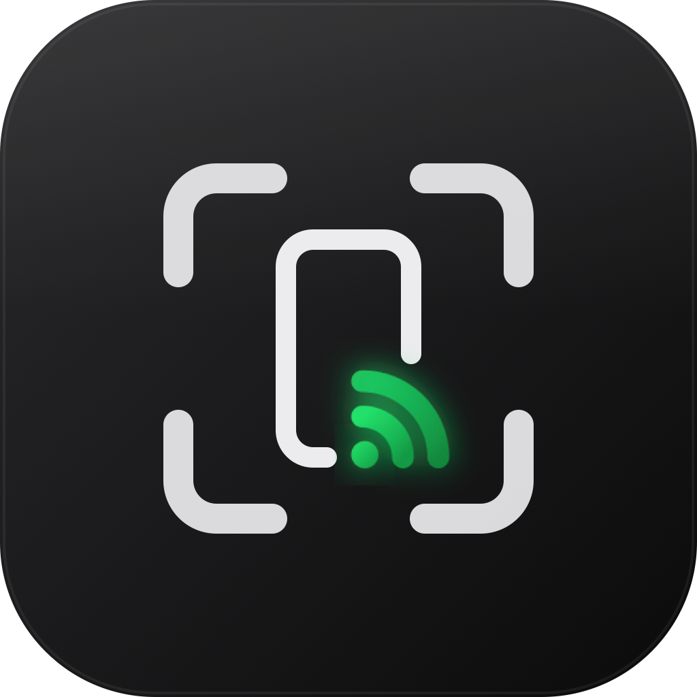
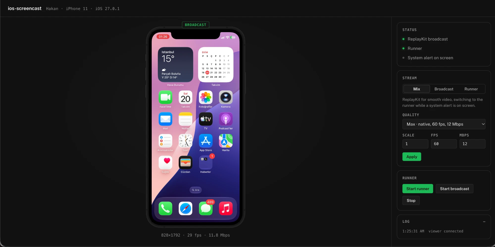

<p align="center"></p>

# ios-screencast

Low-latency H.264 screen streaming from an iPhone to your Mac, including system alerts.

ReplayKit gives smooth 60 fps video but hides some system prompts, such as the location
permission alert. ios-screencast streams ReplayKit and switches to XCTest screenshots while
such an alert is on screen, then back, at keyframes, so the result is one continuous video.



## Install

```bash
brew install hakanor/tap/ios-screencast
```

Then, once: download `ios-screencast.ipa` and `ios-screencast-runner.ipa` from the
[release](https://github.com/hakanor/ios-screencast/releases/latest), sign both with
your own tool (Sideloadly, AltStore, fastlane `resign`, ...) and install them on the phone.

On the phone, enable Settings > Privacy & Security > Developer Mode and
Settings > Developer > Enable UI Automation.

## Use

With the phone connected over USB and unlocked:

```bash
ios-screencast start
```

This connects to the phone (port forwarding, iOS 17.4+ tunnel without sudo, developer disk
image), starts the runner, starts the broadcast and serves the viewer at http://localhost:1881.
No Xcode needed. Ctrl+C stops.

| Mode | Source | Use when |
|---|---|---|
| `--mode mix` (default) | ReplayKit, runner while a system alert is visible | Smooth video that still shows permission prompts |
| `--mode broadcast` | ReplayKit only | Smoothest, alerts not needed |
| `--mode runner` | Runner screenshots only | Everything visible, lower fps |

| Option | Default | |
|---|---|---|
| `--fps` | 60 | Frames per second |
| `--scale` | 1.0 | Output scale of the native resolution |
| `--bitrate` | 12 | Mbps |
| `--stay` | off | Stay in the app after starting the broadcast |
| `--broadcast-attempts` | 1 | Automatic broadcast start attempts (0 = never) |
| `--port` | 1881 | Viewer port |
| `--stdout` | off | Also write raw H.264 to stdout |
| `--udid` | first device | Which phone to use |

```bash
ios-screencast start --stdout | ffplay -f h264 -fflags nobuffer -flags low_delay -
```

Other commands: `ios-screencast devices`, `ios-screencast version`, `ios-screencast --help`.

If the screen is already being recorded or mirrored, the broadcast is not started, so an
existing recording is never stopped by accident. If the broadcast does not start (for example
because the sheet was dismissed), the viewer shows why; press **Start broadcast** to try again.

## Viewer

http://localhost:1881 (Chrome or Safari 16.4+)

- **Badge**: the source on screen (`broadcast` / `runner`)
- **Status**: broadcast, runner, system alert, live resolution, fps and bitrate
- **Stream**: mode and quality, applied immediately
- **Runner**: Start runner, Start broadcast, Stop
- **Log**: what is happening, step by step

The phone is shown in its real device frame, generated from your own Xcode by
[ios-device-frames](https://github.com/hakanor/ios-device-frames) the first time
`ios-screencast start` runs. Without Xcode the viewer uses a plain frame.

## Troubleshooting

| Problem | Fix |
|---|---|
| `ios-screencast is not installed` | Install both IPAs |
| Runner does not start, "unlock the phone" | Unlock the phone; check that UI Automation is enabled |
| `could not start a tunnel` | iOS 17.0–17.3 has no tunnel without sudo; update the phone |
| `cannot forward port` | An old `ios forward` holds the port: `pkill -f "ios forward"` |
| `address already in use` | Another `ios-screencast start` is running; stop it or pass `--port` |
| Need more detail | `SCREENCAST_DEBUG=1 ios-screencast start` |

## How it works

The phone side ships as the two IPAs in each release:
a ReplayKit broadcast extension (device port 12100) and an XCTest runner (port 12101) that
watches for system alerts and streams screenshots while one is visible. Both encode upright
H.264 at the same resolution. This CLI talks to the phone through
[go-ios](https://github.com/danielpaulus/go-ios), mixes the two streams and serves the viewer
(WebCodecs; Chrome or Safari 16.4+).

## Build

```bash
make build
```

Tagging `v*` runs the release workflow, which attaches a universal macOS binary.
The IPAs of the same version are attached from the (private) agent sources.
Then update the version and sha256 in `packaging/homebrew/ios-screencast.rb` and copy it to
[homebrew-tap](https://github.com/hakanor/homebrew-tap) as `Formula/ios-screencast.rb`.

## License

The CLI is MIT licensed. The IPAs are free to download, sign and use; their source is not public.
